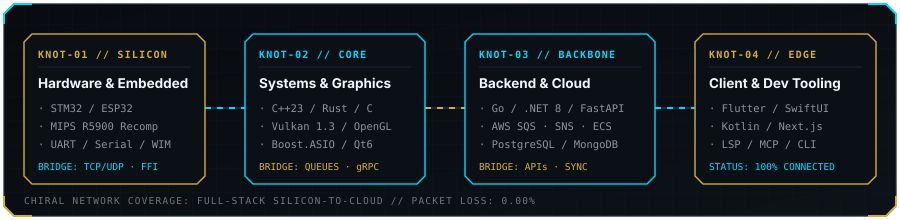
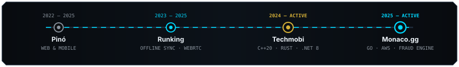

<div align="center">
  

  <br />

  [](https://sidequestlab.dev)
  [](./resume.md)
  [](https://www.linkedin.com/in/matheus-alves-dev/)
  [](mailto:matheus2ep@gmail.com)
</div>

<br />

```text
> INITIALIZING CUFF LINK OS v2.0...
> SCANNING FOR TIMEFALL... [NOMINAL]
> ODRADEK TERRAIN SCAN... [4 KNOTS CONNECTED]
> PORTER: MATHEUS NUNES (@matpdev)  |  GRADE: LEGEND OF LEGENDS
> MISSION: CONNECTING SILICON, CONCURRENT SYSTEMS & PRODUCTION CLOUD
```

I deliver **low-level, high-throughput, and resilient software** across rugged terrain — from static PS2 recompilation and **Vulkan / C++23** engines to **Rust / Go / .NET** distributed backends, embedded **TCP/UDP** telemetry pipelines, and local-first **Flutter / SwiftUI / Kotlin** apps.

<br />

<div align="center">
  
  <br /><br />
  
</div>

<br />

<div align="center">
  
</div>

<br />

<table width="100%">
  <tr>
    <td width="50%" valign="top">
      <p>
        
        
      </p>
      <h3><a href="https://github.com/matpdev/SaintSeiyaRecomp">SaintSeiyaRecomp</a></h3>
      <p><strong>Cargo:</strong> Native PC port &amp; static recompilation of <em>Saint Seiya: The Hades</em> (PS2)</p>
      <p>Translates all <strong>13,855 MIPS R5900 functions</strong> to native C for Linux &amp; Windows, paired with a custom <strong>Vulkan</strong> renderer and an emulated <strong>SPU2</strong> running the original audio driver.</p>
      <p><code>C</code> · <code>Python</code> · <code>Vulkan</code> · <code>MIPS</code></p>
    </td>
    <td width="50%" valign="top">
      <p>
        
        
      </p>
      <h3><a href="https://github.com/matpdev/tinstar">Tinstar</a></h3>
      <p><strong>Cargo:</strong> The law in your repo — deterministic checks from plain-language rules</p>
      <p>Compiles rules written in <code>AGENTS.md</code> / <code>CLAUDE.md</code> into fast checks that run <strong>without an LLM</strong> in the terminal, Zed/editor LSP, CI, and AI agent loops.</p>
      <p><code>Rust</code> · <code>ast-grep</code> · <code>LSP</code> · <code>MCP</code></p>
    </td>
  </tr>
  <tr>
    <td width="50%" valign="top">
      <p>
        
        
      </p>
      <h3><a href="https://github.com/matpdev/cpp-gen">cpp-gen</a></h3>
      <p><strong>Cargo:</strong> Modern C++ project scaffolder distributed via Homebrew &amp; AUR</p>
      <p>Native Go CLI/TUI that fabricates CMake 3.20+ presets, <code>vcpkg</code> / <code>FetchContent</code>, Clangd LSP, AddressSanitizer, and Vulkan/IDE templates in seconds.</p>
      <p><code>Go</code> · <code>Cobra</code> · <code>CMake</code> · <code>Clangd</code></p>
    </td>
    <td width="50%" valign="top">
      <p>
        
        
      </p>
      <h3><a href="https://codeberg.org/l0gic_br4in/parking-simulator">Car Physics &amp; Parking Simulator</a></h3>
      <p><strong>Cargo:</strong> Manual transmission &amp; tire dynamics simulation from scratch</p>
      <p>Models an engine torque curve, slipping clutch, 5-speed gearbox + reverse, load transfer, and <strong>Pacejka tire physics</strong> with real-time telemetry.</p>
      <p><code>C++23</code> · <code>raylib</code> · <code>Dear ImGui</code> · <code>CMake</code></p>
    </td>
  </tr>
  <tr>
    <td width="50%" valign="top">
      <p>
        
        
      </p>
      <h3>SentinelAI</h3>
      <p><strong>Cargo:</strong> Event-driven AIOps &amp; automated incident diagnosis copilot</p>
      <p>Ingests production telemetry through <strong>AWS SQS + S3</strong> and <strong>PostgreSQL/Dapper</strong>, with PII sanitization, <code>Microsoft.Extensions.AI</code>, OpenTelemetry, Grafana, and Testcontainers + BDD.</p>
      <p><code>.NET</code> · <code>AWS SQS/S3</code> · <code>PostgreSQL</code> · <code>OpenTelemetry</code></p>
    </td>
    <td width="50%" valign="top">
      <p>
        
        
      </p>
      <h3>Foco (Mac + Guard)</h3>
      <p><strong>Cargo:</strong> Cross-device focus ecosystem without root or lock-in</p>
      <p>A <strong>SwiftUI</strong> macOS study/roadmap app paired with a <strong>Kotlin + Shizuku</strong> Android blocker communicating over a custom local-network protocol signed with <strong>HMAC + Bonjour</strong>.</p>
      <p><code>SwiftUI</code> · <code>Kotlin</code> · <code>Shizuku</code> · <code>HMAC</code></p>
    </td>
  </tr>
</table>

<details>
  <summary><strong><code>[+] OPEN PRIVATE ROOM ARCHIVE (SECONDARY DELIVERIES &amp; LABS)</code></strong></summary>
  <br />
  <table width="100%">
    <tr>
      <th align="left" width="22%">Order</th>
      <th align="left" width="56%">Mission Scope</th>
      <th align="left" width="22%">Loadout</th>
    </tr>
    <tr>
      <td><strong>docs-lsp</strong></td>
      <td>Offline hover Language Server for Vulkan docs, cppreference, man pages, and GLSL qualifiers running alongside <code>clangd</code>.</td>
      <td><code>LSP</code> · <code>Vulkan</code> · <code>GLSL</code></td>
    </tr>
    <tr>
      <td><strong>El Recrutador</strong></td>
      <td>Local-first job triage &amp; 1-page ATS CV generator using embedded Typst, DeepSeek JSON mode, and SQLite.</td>
      <td><code>Flutter</code> · <code>Rust FFI</code> · <code>Typst</code></td>
    </tr>
    <tr>
      <td><strong>Conta Certa</strong></td>
      <td>100% offline shopping list with real-time calculator and spending cap powered by a Rust core.</td>
      <td><code>Flutter</code> · <code>Rust FFI</code> · <code>SQLite</code></td>
    </tr>
    <tr>
      <td><strong>Vulkan &amp; Game Labs</strong></td>
      <td>Experimental 2D/3D engines, dynamic rendering, VMA, RAII Vulkan wrappers (<code>vklib</code>), and ESP-IDF/PlatformIO hardware experiments.</td>
      <td><code>C++20/23</code> · <code>Vulkan 1.3</code> · <code>ESP32</code></td>
    </tr>
  </table>
</details>

<br />

<div align="center">
  
  <br /><br />
  
</div>

<br />

<table width="100%">
  <tr>
    <th align="left" width="18%">Period</th>
    <th align="left" width="18%">Knot / Partner</th>
    <th align="left" width="22%">Role</th>
    <th align="left" width="42%">Delivery Impact</th>
  </tr>
  <tr>
    <td><strong>Aug 2025 — Present</strong></td>
    <td><strong>Monaco.gg</strong></td>
    <td>Software Engineer / Product Builder</td>
    <td>Core backend &amp; real-time fraud detection for carrier-billed gaming platforms (Claro, Vivo, TIM); async <strong>AWS SQS/SNS/ECS</strong> queues and <strong>MongoDB</strong> replicas stable under traffic bursts (<code>Go</code>, <code>FastAPI</code>, <code>Next.js</code>, <code>SvelteKit</code>).</td>
  </tr>
  <tr>
    <td><strong>2024 — Present</strong></td>
    <td><strong>Techmobi Tecnologia</strong></td>
    <td>Software Engineer (Contract)</td>
    <td>Eliminated race conditions in weigh-in-motion (WIM) sensor diagnostics (<strong>Qt6/C++20</strong>, <strong>Boost.ASIO</strong>) reaching <strong>100% field stability</strong>; modeled <strong>40+ domain entities</strong> in <strong>.NET 8 DDD/CQRS</strong>; built <strong>Rust + Tokio + Flutter FFI</strong> hardware simulators &amp; relays.</td>
  </tr>
  <tr>
    <td><strong>2023 — 2025</strong></td>
    <td><strong>Runking</strong></td>
    <td>Backend &amp; Mobile Engineer</td>
    <td>Engineered an offline-first sync engine (<strong>SQLite + Rust FFI</strong>) and <strong>WebRTC over UDP</strong> telemetry streaming for <strong>zero data loss</strong> during live marathons.</td>
  </tr>
  <tr>
    <td><strong>Feb 2022 — Aug 2025</strong></td>
    <td><strong>Pinó</strong></td>
    <td>Full Stack / Frontend Engineer</td>
    <td>Led frontend architecture for enterprise portals and high-traffic apps (<code>React</code>, <code>Next.js</code>, <code>Vue</code>, <code>React Native</code>, <code>Flutter</code>) backed by Node.js APIs on AWS.</td>
  </tr>
</table>

<br />

<div align="center">
  
</div>

<br />

<table width="100%">
  <tr>
    <td width="50%" valign="top">
      <p><strong><code>PCC-01 // CORE LANGUAGES</code></strong></p>
      <p>
        
        
        
        
        
        
        
        
        
      </p>
    </td>
    <td width="50%" valign="top">
      <p><strong><code>PCC-02 // SYSTEMS, GRAPHICS &amp; EMBEDDED</code></strong></p>
      <p>
        
        
        
        
        
        
        
      </p>
    </td>
  </tr>
  <tr>
    <td width="50%" valign="top">
      <p><strong><code>PCC-03 // BACKEND, CLOUD &amp; DATA</code></strong></p>
      <p>
        
        
        
        
        
        
        
      </p>
    </td>
    <td width="50%" valign="top">
      <p><strong><code>PCC-04 // MOBILE, WEB &amp; DEV TOOLING</code></strong></p>
      <p>
        
        
        
        
        
        
        
      </p>
    </td>
  </tr>
</table>

<br />

<div align="center">
  
  <br /><br />
  
  <br /><br />
  <sub>
    <code>"Tomorrow is in your hands. Keep on keeping on."</code> — Synced daily via <a href="./.github/workflows/update-telemetry.yml">GitHub Actions</a> · Field logs at <a href="https://sidequestlab.dev">sidequestlab.dev</a>
  </sub>
</div>
