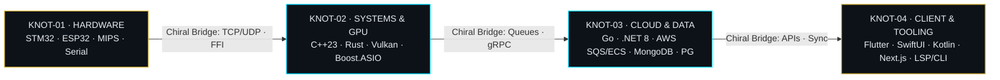

<div align="center">
  

  <br />

  [](https://sidequestlab.dev)
  [](./resume.md)
  [](https://www.linkedin.com/in/matheus-alves-dev/)
  [](mailto:matheus2ep@gmail.com)
</div>

<br />

```text
> INITIALIZING CUFF LINK OS v2.0...
> SCANNING FOR TIMEFALL... [NOMINAL]
> ODRADEK TERRAIN SCAN... [4 KNOTS CONNECTED]
> PORTER: MATHEUS NUNES (@matpdev)  |  GRADE: LEGEND OF LEGENDS
> MISSION: CONNECTING SILICON, CONCURRENT SYSTEMS & PRODUCTION CLOUD
```

I deliver **low-level, high-throughput, and resilient software** across rugged terrain — from static PS2 recompilation and **Vulkan / C++23** engines to **Rust / Go / .NET** distributed backends, embedded **TCP/UDP** telemetry pipelines, and local-first **Flutter / SwiftUI / Kotlin** apps.

<div align="center">
  
</div>

## `// KNOT NETWORK TOPOLOGY`



<div align="center">
  
</div>

## `// STANDARD ORDERS — PERSONAL & OPEN SOURCE`

<table>
  <tr>
    <td width="50%" valign="top">
      <h3><code>ORDER #001 · [RECOMP]</code> <a href="https://github.com/matpdev/SaintSeiyaRecomp">SaintSeiyaRecomp</a></h3>
      <p><strong>Cargo:</strong> Native PC port &amp; static recompilation of <em>Saint Seiya: The Hades</em> (PS2)</p>
      <p>Translates all <strong>13,855 MIPS R5900 functions</strong> to native C for Linux &amp; Windows, paired with a custom <strong>Vulkan</strong> renderer and an emulated <strong>SPU2</strong> running the original audio driver.</p>
      <p><strong>Loadout:</strong> <code>C</code> · <code>Python</code> · <code>Vulkan</code> · <code>MIPS</code> · <em>Rank: S</em></p>
    </td>
    <td width="50%" valign="top">
      <h3><code>ORDER #002 · [AI-LAW]</code> <a href="https://github.com/matpdev/tinstar">Tinstar</a></h3>
      <p><strong>Cargo:</strong> The law in your repo — deterministic checks from plain-language rules</p>
      <p>Compiles rules written in <code>AGENTS.md</code> / <code>CLAUDE.md</code> into fast checks that run <strong>without an LLM</strong> in the terminal, Zed/editor LSP, CI, and AI agent loops.</p>
      <p><strong>Loadout:</strong> <code>Rust</code> · <code>ast-grep</code> · <code>LSP</code> · <code>MCP</code> · <em>Rank: S</em></p>
    </td>
  </tr>
  <tr>
    <td width="50%" valign="top">
      <h3><code>ORDER #003 · [PCC-CLI]</code> <a href="https://github.com/matpdev/cpp-gen">cpp-gen</a></h3>
      <p><strong>Cargo:</strong> Modern C++ project scaffolder distributed via Homebrew &amp; AUR</p>
      <p>Native Go CLI/TUI that fabricates CMake 3.20+ presets, <code>vcpkg</code> / <code>FetchContent</code>, Clangd LSP, AddressSanitizer, and Vulkan/IDE templates in seconds.</p>
      <p><strong>Loadout:</strong> <code>Go</code> · <code>Cobra</code> · <code>CMake</code> · <code>Clangd</code> · <em>Rank: S</em></p>
    </td>
    <td width="50%" valign="top">
      <h3><code>ORDER #004 · [PHYSICS]</code> <a href="https://codeberg.org/l0gic_br4in/parking-simulator">Car Physics &amp; Parking Simulator</a></h3>
      <p><strong>Cargo:</strong> Manual transmission &amp; tire dynamics simulation from scratch</p>
      <p>Models an engine torque curve, slipping clutch, 5-speed gearbox + reverse, load transfer, and <strong>Pacejka tire physics</strong> with real-time telemetry.</p>
      <p><strong>Loadout:</strong> <code>C++23</code> · <code>raylib</code> · <code>Dear ImGui</code> · <code>CMake</code> · <em>Rank: S</em></p>
    </td>
  </tr>
  <tr>
    <td width="50%" valign="top">
      <h3><code>ORDER #005 · [AIOPS]</code> SentinelAI</h3>
      <p><strong>Cargo:</strong> Event-driven AIOps &amp; automated incident diagnosis copilot</p>
      <p>Ingests production telemetry through <strong>AWS SQS + S3</strong> and <strong>PostgreSQL/Dapper</strong>, with PII sanitization, <code>Microsoft.Extensions.AI</code>, OpenTelemetry, Grafana, and Testcontainers + BDD.</p>
      <p><strong>Loadout:</strong> <code>.NET</code> · <code>AWS SQS/S3</code> · <code>PostgreSQL</code> · <code>OpenTelemetry</code></p>
    </td>
    <td width="50%" valign="top">
      <h3><code>ORDER #006 · [PROTOCOL]</code> Foco (Mac + Guard)</h3>
      <p><strong>Cargo:</strong> Cross-device focus ecosystem without root or lock-in</p>
      <p>A <strong>SwiftUI</strong> macOS study/roadmap app paired with a <strong>Kotlin + Shizuku</strong> Android blocker communicating over a custom local-network protocol signed with <strong>HMAC + Bonjour</strong>.</p>
      <p><strong>Loadout:</strong> <code>SwiftUI</code> · <code>Kotlin</code> · <code>Shizuku</code> · <code>HMAC</code></p>
    </td>
  </tr>
</table>

<details>
  <summary><strong><code>[+] OPEN PRIVATE ROOM ARCHIVE (SECONDARY DELIVERIES &amp; LABS)</code></strong></summary>
  <br />
  <table>
    <tr>
      <th align="left">Order</th>
      <th align="left">Mission Scope</th>
      <th align="left">Loadout</th>
    </tr>
    <tr>
      <td><strong>docs-lsp</strong></td>
      <td>Offline hover Language Server for Vulkan docs, cppreference, man pages, and GLSL qualifiers running alongside <code>clangd</code>.</td>
      <td><code>LSP</code> · <code>Vulkan</code> · <code>C++</code> · <code>GLSL</code></td>
    </tr>
    <tr>
      <td><strong>El Recrutador</strong></td>
      <td>Local-first job triage &amp; 1-page ATS CV generator using embedded Typst, DeepSeek JSON mode, and SQLite.</td>
      <td><code>Flutter</code> · <code>Rust FFI</code> · <code>Typst</code> · <code>SQLite</code></td>
    </tr>
    <tr>
      <td><strong>Conta Certa</strong></td>
      <td>100% offline shopping list with real-time calculator and spending cap powered by a Rust core.</td>
      <td><code>Flutter</code> · <code>Rust FFI</code> · <code>SQLite</code></td>
    </tr>
    <tr>
      <td><strong>Vulkan &amp; Game Labs</strong></td>
      <td>Experimental 2D/3D engines, dynamic rendering, VMA, RAII Vulkan wrappers (<code>vklib</code>), and ESP-IDF/PlatformIO hardware experiments.</td>
      <td><code>C++20/23</code> · <code>Vulkan 1.3</code> · <code>ESP32</code></td>
    </tr>
  </table>
</details>

<div align="center">
  
</div>

## `// STRAND CONTRACTS — FIELD DEPLOYMENTS`

| Period | Knot / Partner | Role | Delivery Impact |
| :--- | :--- | :--- | :--- |
| **Aug 2025 — Present** | **Monaco.gg** | Software Engineer / Product Builder | Core backend &amp; real-time fraud detection for carrier-billed gaming platforms (Claro, Vivo, TIM); async **AWS SQS/SNS/ECS** queues and **MongoDB** replicas stable under traffic bursts (`Go`, `FastAPI`, `Next.js`, `SvelteKit`). |
| **2024 — Present** | **Techmobi Tecnologia** | Software Engineer (Contract) | Eliminated race conditions in weigh-in-motion (WIM) sensor diagnostics (**Qt6/C++20**, **Boost.ASIO**) reaching **100% field stability**; modeled **40+ domain entities** in **.NET 8 DDD/CQRS**; built **Rust + Tokio + Flutter FFI** hardware simulators &amp; relays. |
| **2023 — 2025** | **Runking** | Backend &amp; Mobile Engineer | Engineered an offline-first sync engine (**SQLite + Rust FFI**) and **WebRTC over UDP** telemetry streaming for **zero data loss** during live marathons. |
| **Feb 2022 — Aug 2025** | **Pinó** | Full Stack / Frontend Engineer | Led frontend architecture for enterprise portals and high-traffic apps (`React`, `Next.js`, `Vue`, `React Native`, `Flutter`) backed by Node.js APIs on AWS. |

<div align="center">
  
</div>

## `// PCC FABRICATION LOADOUT — TECH STACK`

<details open>
  <summary><strong><code>[+] INSPECT CHIRAL PRINTER BLUEPRINTS</code></strong></summary>
  <br />

  - **Core Languages**: `C++ (20/23)` · `Rust` · `Go` · `C# (.NET 8)` · `TypeScript` · `Python` · `Kotlin` · `Swift` · `Dart` · `SQL`
  - **Systems, Graphics &amp; Embedded**: `Linux Systems` · `Vulkan 1.3 (VMA)` · `OpenGL` · `GLSL` · `Qt6` · `Boost.ASIO` · `POSIX Threads` · `TCP/UDP` · `WebRTC` · `STM32 / ESP32`
  - **Backend, Cloud &amp; Data**: `AWS (SQS, SNS, ECS, S3, ALB)` · `Docker` · `PostgreSQL` · `MongoDB` · `Redis` · `SQLite` · `OpenTelemetry` · `Grafana`
  - **Mobile, Web &amp; Tooling**: `Flutter (flutter_rust_bridge)` · `SwiftUI` · `Next.js` · `SvelteKit` · `CMake` · `LSP / MCP` · `GitHub Actions`

</details>

<div align="center">
  
</div>

## `// CUFF LINK TELEMETRY & BRIDGE LINK`

<div align="center">
  
  <br /><br />
  <sub>
    <code>"Tomorrow is in your hands. Keep on keeping on."</code> — Synced daily via <a href="./.github/workflows/update-telemetry.yml">GitHub Actions</a> · Field logs at <a href="https://sidequestlab.dev">sidequestlab.dev</a>
  </sub>
</div>
